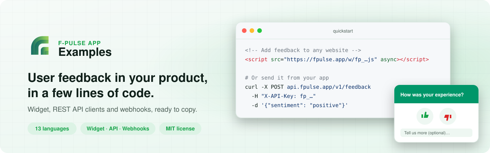
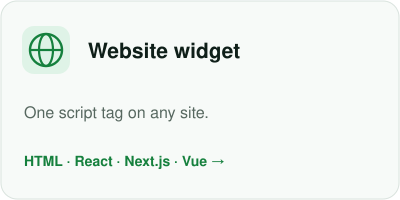
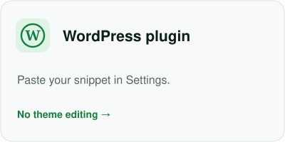
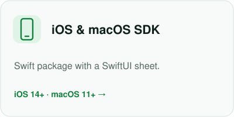
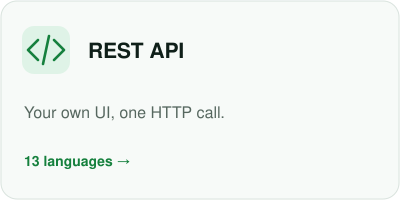
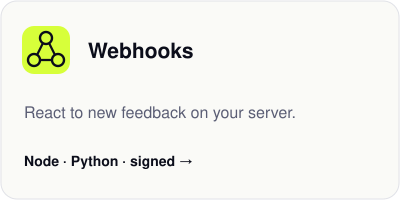
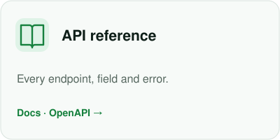
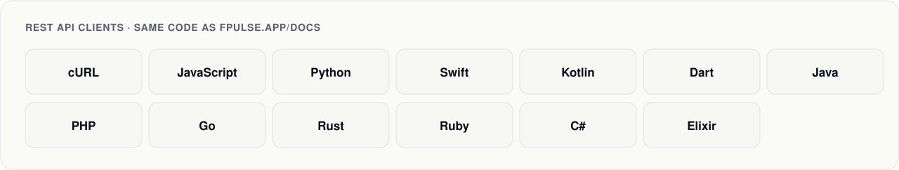

<a href="https://fpulse.app?utm_source=github&utm_medium=examples">
  <picture><source media="(prefers-color-scheme: dark)" srcset="assets/banner-dark.svg"></picture>
</a>

<p align="center">
  <a href="LICENSE"></a>
  <a href="rest-api"></a>
  <a href="https://fpulse.app/docs?utm_source=github&utm_medium=examples"></a>
  <a href="https://fpulse.app/pricing?utm_source=github&utm_medium=examples"></a>
</p>

<p align="center">
  <a href="#pick-your-path">Pick your path</a> ·
  <a href="#quick-start">Quick start</a> ·
  <a href="#rest-api-clients">REST API clients</a> ·
  <a href="#whats-inside">What's inside</a> ·
  <a href="#good-to-know">Good to know</a>
</p>

[F-Pulse App](https://fpulse.app?utm_source=github&utm_medium=examples) collects ratings and comments from your users (thumbs, emoji, stars or NPS),
shows sentiment trends in a dashboard and uses AI to tell you what to fix first.
This repository has copy-paste examples for every way to send feedback to it.

## Pick your path

<p>
  <a href="website-widget"><picture><source media="(prefers-color-scheme: dark)" srcset="assets/card-website-widget-dark.svg"></picture></a>
  <a href="website-widget/wordpress-plugin"><picture><source media="(prefers-color-scheme: dark)" srcset="assets/card-wordpress-dark.svg"></picture></a>
  <a href="https://github.com/Fpulse-App/fpulse-ios-sdk"><picture><source media="(prefers-color-scheme: dark)" srcset="assets/card-ios-sdk-dark.svg"></picture></a>
  <br>
  <a href="rest-api"><picture><source media="(prefers-color-scheme: dark)" srcset="assets/card-rest-api-dark.svg"></picture></a>
  <a href="webhooks"><picture><source media="(prefers-color-scheme: dark)" srcset="assets/card-webhooks-dark.svg"></picture></a>
  <a href="https://fpulse.app/docs?utm_source=github&utm_medium=examples"><picture><source media="(prefers-color-scheme: dark)" srcset="assets/card-docs-dark.svg"></picture></a>
</p>

## Quick start

### 1. Get your keys

[Create a free account](https://fpulse.app/auth/register?utm_source=github&utm_medium=examples) and a project, then:

| Key | Looks like | Where to find it | Use it for |
|-----|-----------|------------------|------------|
| Widget ID | `fp_ab12cd34ef56gh` | Dashboard > **Widget** (copy the snippet) | The website widget |
| API key | `fp_...` | Shown when you create a project | Sending feedback from apps and servers |
| Read key | `fpsk_...` | **Projects > Settings > Read Key for the API** | Reading feedback through the API |

> [!WARNING]
> The **read key** can download all your feedback. Keep it on your server and never put it in a website or an app.
> The API key and the widget ID can only *send* feedback, so they are safe to ship.

### 2. Send your first feedback

```sh
curl -X POST https://api.fpulse.app/v1/feedback \
  -H "Content-Type: application/json" \
  -H "X-API-Key: fp_your_api_key_here" \
  -d '{"sentiment": "positive", "comment": "Hello from cURL", "app_version": "1.0.0", "app_type": "other", "environment": "development"}'
```

It appears in your dashboard right away. Switch the environment to **Development** to see it.

> [!TIP]
> Send `"environment": "development"` from test builds (or add `?env=dev` to the widget URL),
> so test feedback never mixes with your real numbers.

### 3. Or add the widget to a website

```html
<script src="https://fpulse.app/w/YOUR_WIDGET_ID.js" async></script>
```

Paste it before `</body>`. Colors, texts, rating type and position are set in the dashboard.
Setups for [React](website-widget/react), [Next.js](website-widget/nextjs), [Vue](website-widget/vue) and
[WordPress](website-widget/wordpress-plugin) are in [`website-widget/`](website-widget).

## REST API clients

<a href="rest-api">
  <picture><source media="(prefers-color-scheme: dark)" srcset="assets/languages-dark.svg"></picture>
</a>

Each client sends feedback with your API key and returns the new feedback ID. They are the same examples as on
[fpulse.app/docs](https://fpulse.app/docs?utm_source=github&utm_medium=examples). How to run each one is in [`rest-api/README.md`](rest-api/README.md).

## What's inside

```text
fpulse-examples/
├── website-widget/        Feedback button for any website
│   ├── html/              Plain HTML
│   ├── react/             Vite or Create React App
│   ├── nextjs/            App Router layout with next/script
│   ├── vue/               Vue and Nuxt
│   └── wordpress-plugin/  WordPress plugin (Settings > F-Pulse Feedback)
├── rest-api/              Send feedback from apps and servers, 13 languages
│   └── curl/ javascript/ python/ swift/ kotlin/ dart/ java/ php/ go/ rust/ ruby/ csharp/ elixir/
└── webhooks/              Receive events on your server, with signature checks
    ├── node/
    └── python/
```

## Good to know

| | Free | Pro | Enterprise |
|---|---:|---:|---:|
| API requests per minute, per project | 100 | 1,000 | 10,000 |
| Feedbacks per month | 1,000 | 50,000 | Unlimited |
| Webhooks | | ✓ | ✓ |

- **Base URL:** `https://api.fpulse.app/v1` (also `https://fpulse.app/api/v1`).
- **Over the rate limit** the API answers `429` with a `Retry-After` header.
- **Full reference:** [fpulse.app/docs](https://fpulse.app/docs?utm_source=github&utm_medium=examples) and the [OpenAPI spec](https://fpulse.app/static/openapi.json).

## Contributing

Found a bug in an example or want another language or framework? [Open an issue](https://github.com/Fpulse-App/fpulse-examples/issues/new/choose)
or a pull request. See [CONTRIBUTING.md](CONTRIBUTING.md).

## License

The examples are [MIT licensed](LICENSE). The WordPress plugin in `website-widget/wordpress-plugin/` is GPLv2 or later, as WordPress requires.

<p align="center">
  <a href="https://fpulse.app?utm_source=github&utm_medium=examples">Website</a> ·
  <a href="https://fpulse.app/docs?utm_source=github&utm_medium=examples">Docs</a> ·
  <a href="https://fpulse.app/demo?utm_source=github&utm_medium=examples">Live demo</a> ·
  <a href="https://github.com/Fpulse-App">More from F-Pulse App</a>
</p>
